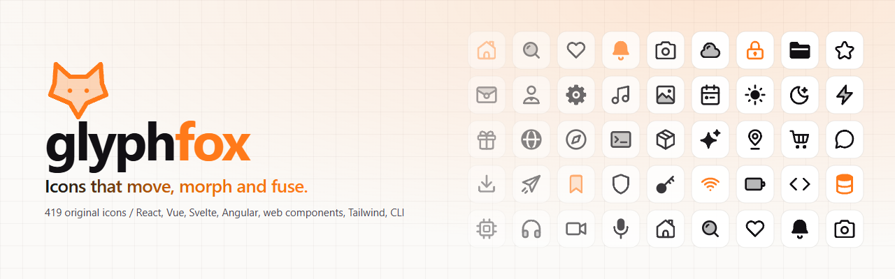

<p align="center">
  <a href="https://kwy404.github.io/glyphfox/">
    <picture>
      <source media="(prefers-color-scheme: dark)" srcset="assets/banner-dark.png">
      
    </picture>
  </a>
</p>

<p align="center">
  <a href="https://www.npmjs.com/package/glyphfox"></a>
  <a href="https://www.npmjs.com/package/glyphfox"></a>
  <a href="https://github.com/kwy404/glyphfox/actions/workflows/ci.yml"></a>
  <a href="https://www.jsdelivr.com/package/npm/glyphfox"></a>
  <a href="LICENSE"></a>
</p>

# glyphfox

Original open source icons on a 24 grid that do more than sit still. Every icon is **variable** (weight, corners and style axes), **morphs** into any other icon, **fuses** with other icons into new ones that still pass the rules, takes **modifier badges** in any corner and comes with **living states** (draw, pop, wiggle, spin, pulse, bounce, shake). One set of props works the same in React (Server Components included), Vue, Svelte, Angular, Solid, Preact, Qwik, Lit, Astro, React Native, Ember, the `<glyph-fox>` web component, Tailwind CSS, the CDN and the CLI.

**[Open the studio](https://kwy404.github.io/glyphfox/)** to browse, customize, morph, fuse, draw your own icons, Fox-ify any SVG, search by sketch, export a brand kit and render icons in 3D.

[Português (Brasil)](i18n/README.pt-BR.md)

## Contents

- [Install](#install)
- [Quick start](#quick-start): [React](#react), [Vue](#vue), [Svelte](#svelte), [Angular](#angular), [Solid](#solid), [Preact](#preact), [Qwik](#qwik), [Lit](#lit), [Astro](#astro), [React Native](#react-native), [Ember](#ember), [Web component and CDN](#web-component-and-cdn), [Tailwind CSS](#tailwind-css), [Plain HTML](#plain-html), [JavaScript](#javascript)
- [Recipes](#recipes): [Next.js App Router](#nextjs-app-router-with-server-components), [Nuxt](#nuxt), [SvelteKit](#sveltekit), [Remix and React Router](#remix-and-react-router), [Alpine](#alpine), [htmx](#htmx)
- [Props](#props)
- [Name syntax](#name-syntax)
- [Variable axes](#variable-axes) · [Morph](#morph) · [Fusion](#fusion) · [Living states](#living-states) · [Modifiers](#modifiers)
- [CLI](#cli)
- [Native exports](#native-exports): Android, Jetpack Compose, iOS, SwiftUI, Flutter
- [Glyph script](#glyph-script)
- [Scan and exports](#scan-and-exports)
- [The studio](#the-studio)
- [Social icons](#social-icons)
- [Icon rules](#icon-rules)

## Install

```sh
npm install glyphfox
```

`glyphfox` has no dependencies. React, Vue, Svelte, Solid, Preact, Qwik, Lit, Astro, React Native (with `react-native-svg`), Ember and Tailwind CSS are optional peer dependencies, used only when you import their entry points. Angular lives in its own package:

```sh
npm install glyphfox-angular
```

## Quick start

### React

```jsx
import { HomeIcon, FileIcon, Fusion, MorphIcon } from 'glyphfox/react';

export function Toolbar({ open, saved }) {
  return (
    <>
      <HomeIcon />
      <FileIcon size={20} weight={1.5} modifier={saved ? 'check' : undefined} />
      <Fusion icons={['cloud', 'lock']} layout="overlap" />
      <MorphIcon name={open ? 'x' : 'menu'} />
    </>
  );
}
```

Components are tree shakable (`/*#__PURE__*/`, `sideEffects: false`), use `forwardRef`, and pass `className`, `style` and every SVG attribute through. Deep imports work too: `import { FileIcon } from 'glyphfox/react/icons/file'`. The `useMorph(name, { duration })` hook returns icon data that morphs whenever `name` changes.

The modules are marked `'use client'`, so Server Components can render them as client components. For icons that ship no JavaScript at all, `glyphfox/react/server` has hook free `Icon` and `Fusion` server components with every icon available by name:

```jsx
import { Icon, Fusion } from 'glyphfox/react/server';

<Icon name="file+check@tr" size={20} variant="duotone" />
<Fusion icons={['cloud', 'lock']} layout="overlap" />
```

### Vue

```vue
<script setup>
import { HomeIcon, Fusion, MorphIcon } from 'glyphfox/vue';
</script>

<template>
  <HomeIcon :size="32" color="#ff7a1a" variant="duotone" />
  <Fusion :icons="['file', 'check']" layout="badge" />
  <MorphIcon :name="playing ? 'pause' : 'play'" />
</template>
```

`useMorph(nameRef)` is the composable equivalent of the React hook.

### Svelte

```svelte
<script>
  import { HeartIcon, Fusion } from 'glyphfox/svelte';
  let liked = $state(false);
</script>

<button onclick={() => (liked = !liked)}>
  <HeartIcon animate="pop" trigger="state" active={liked} variant={liked ? 'solid' : 'outline'} />
</button>
<Fusion icons={['user', 'shield']} layout="badge" />
```

Svelte 5. `morphStore('menu')` is a store that morphs on every `set(name)`.

### Angular

```ts
import { bootstrapApplication } from '@angular/platform-browser';
import { iconHome, iconFile, iconCheck } from 'glyphfox';
import { GlyphFoxIcon, provideGlyphFox } from 'glyphfox-angular';

bootstrapApplication(App, {
  providers: [provideGlyphFox({ icons: [iconHome, iconFile, iconCheck], defaults: { weight: 1.75 } })],
});
```

```html
<gf-icon name="home" [size]="24"></gf-icon>
<gf-icon name="file+check@tr" variant="duotone"></gf-icon>
<gf-icon [icons]="['cloud', 'lock']" layout="overlap"></gf-icon>
```

`GlyphFoxIcon` is a standalone component with every shared prop as an input. Register only the icons you use, or pass `icons` from `glyphfox` to register all of them.

### Solid

```jsx
import { createSignal } from 'solid-js';
import { HomeIcon, HeartIcon, Fusion, MorphIcon } from 'glyphfox/solid';

export function Toolbar() {
  const [open, setOpen] = createSignal(false);
  return (
    <nav>
      <HomeIcon size={20} class="nav-icon" />
      <HeartIcon animate="pop" trigger="click" variant="duotone" />
      <Fusion icons={['cloud', 'lock']} layout="overlap" />
      <button onClick={() => setOpen(!open())}>
        <MorphIcon name={open() ? 'x' : 'menu'} />
      </button>
    </nav>
  );
}
```

No compiler setup: the same module renders in SolidStart on the server and in the browser. `class`, `style`, `ref` and events reach the svg; `useMorph(accessor)` returns an accessor that morphs when the name changes.

### Preact

```jsx
import { FileIcon, HeartIcon, MorphIcon } from 'glyphfox/preact';

<FileIcon size={20} weight={1.5} modifier="check" class="doc" />
<HeartIcon animate="pop" trigger="click" />
<MorphIcon name={copied ? 'check' : 'copy'} />
```

The React API (`Icon`, `Fusion`, `MorphIcon`, `useMorph`) on `preact` and `preact/hooks`, without `preact/compat`. On Preact 11 a `ref` reaches the svg.

### Qwik

```tsx
import { component$, useSignal } from '@qwik.dev/core';
import { iconX } from 'glyphfox';
import { BellIcon, HomeIcon, MenuIcon, registerIcons } from 'glyphfox/qwik';

registerIcons([iconX]); // names used only by morphTo, Icon or Fusion

export default component$(() => {
  const open = useSignal(false);
  return (
    <header>
      <HomeIcon size={20} class="logo" />
      <BellIcon animate="shake" trigger="hover" />
      <button onClick$={() => (open.value = !open.value)}>
        <MenuIcon morphTo="x" trigger="state" active={open.value} />
      </button>
    </header>
  );
});
```

For Qwik 2 (`@qwik.dev/core`). Lightweight components that render on the server and resume with no JavaScript: living states and `morphTo` run on CSS, `active` switches `trigger="state"`, and `trigger="click"` uses a tiny inline handler. Names in `Icon`, `morphTo` and `Fusion` must be registered: icon components register their icon, and `registerIcons([iconX])` (or `registerIcons(icons)` for the whole set) covers names you only write as strings.

### Lit

```js
import { html } from 'lit';
import { defineIcons, FileIcon, HeartIcon, Icon, Fusion, MorphIcon } from 'glyphfox/lit';

defineIcons([FileIcon, HeartIcon, Icon, Fusion, MorphIcon]); // <gf-file>, <gf-heart>, <gf-glyph>, <gf-fusion>, <gf-morph>

html`
  <gf-file size="20" weight="1.5" modifier="check"></gf-file>
  <gf-heart animate="pop" trigger="click" secondary-color="#ff7a1a"></gf-heart>
  <gf-glyph name="cloud&lock:overlap"></gf-glyph>
  <gf-morph .name=${open ? 'x' : 'menu'}></gf-morph>
`;
```

Lit 3 elements in shadow DOM that also render with `@lit-labs/ssr`. Nothing is defined on import; `defineIcons(list, { prefix: 'my' })` gives `<my-file>`. Attributes are kebab-case, properties camelCase, and the `animate` attribute is the `animatePreset` property (every element already has an `animate()` method), while `animation` plays the designed animation as in every package. `class` and `style` style the host element.

### Astro

```astro
---
import { HomeIcon, Icon, Fusion } from 'glyphfox/astro';
import SearchIcon from 'glyphfox/astro/icons/search';
---

<HomeIcon size={20} class:list={['nav-icon', { active: true }]} />
<SearchIcon weight={1.5} />
<Icon name="file+check@tr" variant="duotone" />
<Fusion icons={['cloud', 'lock']} layout="overlap" />
```

`.astro` components that render static SVG on the server and ship no JavaScript, with every icon available to `Icon`, `morphTo` and `Fusion`. `class`, `style` (string or object) and any attribute pass through.

### React Native

```sh
npm install glyphfox react-native-svg
```

```jsx
import { HomeIcon, BellIcon, MorphIcon } from 'glyphfox/native';

<HomeIcon size={28} color="#ff7a1a" />
<BellIcon animate="shake" trigger="state" active={unread > 0} />
<MorphIcon name={open ? 'x' : 'menu'} style={{ marginLeft: 8 }} />
```

The same components on `react-native-svg`. There is no CSS on native, so living states are sampled frame by frame from the same presets and morphs are tweened, both following the reduce motion setting; `trigger="click"` plays on press. `title` sets the accessibility label and refs reach the `Svg`.

### Ember

```gjs
import { FileIcon, Glyph, Fusion } from 'glyphfox/ember';

<template>
  {{FileIcon size=20 weight=1.5 class="toolbar-icon"}}
  {{Glyph "file+check@tr" variant="duotone"}}
  {{Fusion "cloud" "lock" layout="overlap"}}
</template>
```

Plain function helpers (Ember 4.5 and newer, no addon setup) that return trusted markup, for .gjs, .gts and classic templates. Props, `class`, `style` and attributes are named arguments. Names in `Glyph`, `morphTo` and `Fusion` must be registered: icon helpers register their icon, and `registerIcons([iconCloud])` (or `registerIcons(icons)`) covers the rest.

### Web component and CDN

One file, every icon, no build step:

```html
<script src="https://cdn.jsdelivr.net/npm/glyphfox@1"></script>
<!-- or https://unpkg.com/glyphfox@1 -->

<glyph-fox name="home"></glyph-fox>
<glyph-fox name="file+check" size="32" weight="1.5"></glyph-fox>
<glyph-fox name="cloud&lock" layout="overlap"></glyph-fox>
<glyph-fox name="menu" morph></glyph-fox> <!-- animates when name changes -->
```

Every prop is an attribute in kebab-case (`secondary-color`, `flip-x`, `morph-to`...). With a bundler: `import 'glyphfox/web'` (all icons) or `import { defineGlyphFox } from 'glyphfox/web/element'` (bring your own icons with `registerIcons`). The CDN build also exposes `window.glyphfox` (`toSvg`, `fuse`, `search`...).

### Tailwind CSS

Icons as CSS masks in `currentColor`, so `text-*`, `size-*` and `opacity-*` utilities just work.

```js
// Tailwind v3: tailwind.config.js
module.exports = { plugins: [require('glyphfox/tailwind')] };
```

```css
/* Tailwind v4 */
@import "tailwindcss";
@plugin "glyphfox/tailwind";
```

```html
<span class="gf-home text-2xl text-orange-500"></span>
<span class="gf-[file+check] gf-spin"></span>          <!-- v3 also accepts gf-file+check -->
<span class="gf-[cloud&lock]/side"></span>             <!-- fusion with a layout -->
<span class="gf-heart/solid-sharp-w1.5"></span>        <!-- axes after the slash -->
```

Animations: `gf-spin`, `gf-pulse`, `gf-pop`, `gf-wiggle`, `gf-bounce`, `gf-shake`. Options: `glyphfox({ prefix, size, variant, corners, weight, combos })`.

### Plain HTML

```html
<script type="module">import 'https://cdn.jsdelivr.net/npm/glyphfox@1/dist/runtime/auto.js';</script>
<i data-glyph="search" data-size="20" data-variant="duotone"></i>
```

The runtime replaces every `data-glyph` element with inline SVG, including elements added later.

### JavaScript

```js
import { toSvg, fuse, createMorph, search, getIcon } from 'glyphfox';

toSvg('file', { size: 32, color: '#ff7a1a', variant: 'solid' });
toSvg('file+check@tr');                      // modifier badge
toSvg('cloud&lock:overlap');                 // fusion
toSvg('menu', { morphTo: 'x', trigger: 'hover' }); // CSS only morph
fuse(['cloud', 'lock'], { layout: 'overlap', gap: 1 }); // icon data, passes the lint
search('arrow', { limit: 10 });
search('lixeira');                           // trash, synonyms in five languages
```

`search` understands everyday words in English, Portuguese, Spanish, French and German (`lixeira`, `basura`, `poubelle` and `Mülleimer` all find `trash`), ignores case and accents and handles simple plurals. Pass `lang: 'pt'` to rank a word's meaning in that language first, or `synonyms: false` to match names and tags only. `searchIcons(list, query)` ranks your own icon list the same way.

Also in the package: `glyphfox/icons.json`, `glyphfox/sprite.svg` (`<use href="sprite.svg#gf-home">`), `glyphfox/styles.css` (optional animation classes), `glyphfox/core` (the engine without icon data) and `glyphfox/tools` (lint and Fox-ify).

## Recipes

Longer versions with every step live in the [framework guides](https://kwy404.github.io/glyphfox/frameworks/).

### Next.js App Router with Server Components

```tsx
// app/page.tsx: a Server Component, no JavaScript sent for these icons
import { Icon } from 'glyphfox/react/server';

export default function Page() {
  return <Icon name="bell" animate="shake" trigger="hover" title="Notifications" />;
}
```

```tsx
// app/like-button.tsx
'use client';
import { HeartIcon } from 'glyphfox/react';
```

Server Components render static SVG with `glyphfox/react/server` (every icon by name, CSS living states and hover or state morphs). Use `glyphfox/react` in client components for the click trigger and morph tweens. Add `experimental.optimizePackageImports: ['glyphfox']` to `next.config` or use deep imports (`glyphfox/react/icons/file`). [Full recipe](https://kwy404.github.io/glyphfox/frameworks/nextjs.html).

### Nuxt

```ts
// modules/glyphfox.ts: auto import the components you choose
import { addComponent, defineNuxtModule } from '@nuxt/kit';

export default defineNuxtModule({
  setup() {
    for (const name of ['HomeIcon', 'BellIcon', 'Icon', 'MorphIcon']) addComponent({ name, export: name, filePath: 'glyphfox/vue' });
  },
});
```

`glyphfox/vue` renders on the server and hydrates, with no `build.transpile`. Register icons you only use by name in a plugin (`registerIcons([iconCloud])`) so the server render contains them. [Full recipe](https://kwy404.github.io/glyphfox/frameworks/nuxt.html).

### SvelteKit

```svelte
<script>
  import { HomeIcon } from 'glyphfox/svelte';
  import FileIcon from 'glyphfox/svelte/icons/file';
</script>

<HomeIcon size={20} />
<FileIcon modifier="check" />
```

`glyphfox/svelte` ships `.svelte` sources that SvelteKit compiles, so icons render on the server and prerender to static HTML. Call `registerIcons` in `+layout.js` for icons you only use by name. [Full recipe](https://kwy404.github.io/glyphfox/frameworks/sveltekit.html).

### Remix and React Router

```tsx
// app/root.tsx
import sprite from 'glyphfox/sprite.svg?url';

export const links = () => [{ rel: 'preload', href: sprite, as: 'image', type: 'image/svg+xml' }];
```

`glyphfox/react` works in routes as is, server rendered and hydrated. For long static lists, point `<use>` elements at the cached sprite (`sprite + '#gf-home'`). [Full recipe](https://kwy404.github.io/glyphfox/frameworks/remix.html).

### Alpine

```html
<script src="https://cdn.jsdelivr.net/npm/glyphfox@1"></script>

<div x-data="{ open: false }">
  <button @click="open = !open"><glyph-fox :name="open ? 'x' : 'menu'" morph></glyph-fox></button>
  <span x-html="glyphfox.toSvg(open ? 'heart/solid' : 'heart', { size: 20 })"></span>
</div>
```

`<glyph-fox>` reacts to attribute changes, so Alpine bindings drive every prop and `morph` animates name changes. [Full recipe](https://kwy404.github.io/glyphfox/frameworks/alpine.html).

### htmx

```js
// a server route that answers an htmx request
import { toSvg } from 'glyphfox';

res.send(`<button hx-post="/like" hx-swap="outerHTML">${toSvg('heart/solid', { animate: 'pop' })}</button>`);
```

Render SVG on the server with `toSvg`, return `<glyph-fox>` tags (custom elements upgrade when swapped in), or use the `data-glyph` runtime, which also replaces placeholders that arrive later. [Full recipe](https://kwy404.github.io/glyphfox/frameworks/htmx.html).

## Props

The same props, with the same names and meaning, in every package. Attributes use kebab-case (`secondary-color`). The plain use stays `<HomeIcon />`.

| Prop | Type | Default | Description |
| --- | --- | --- | --- |
| `size` | number or string | `24` | Width and height. Numbers are pixels, strings can be `1em`, `2rem`. |
| `color` | string | `currentColor` | Main color. |
| `secondaryColor` | string | `color` | Color of the duotone layer and of the solid fill. |
| `secondaryOpacity` | number | `0.3` duotone, `1` solid | Opacity of the duotone layer or of the solid fill. |
| `weight` | number | `2` | Weight axis, stroke width from 1 to 3 on the 24 grid. Optically compensated below 24 px. |
| `absoluteWeight` | boolean | `false` | Keeps the stroke at `weight` pixels at any size. |
| `corners` | `round` or `sharp` | `round` | Corners axis: round or sharp joins and caps. |
| `variant` | `outline`, `duotone`, `solid` | `outline` | Style axis. Solid is generated from the closed shapes of each icon. |
| `rotate` | number | `0` | Rotation in degrees. |
| `flipX` | boolean | `false` | Mirror horizontally. |
| `flipY` | boolean | `false` | Mirror vertically. |
| `mirrorRtl` | boolean | `false` | Mirror in right to left layouts. |
| `animate` | `draw`, `pop`, `wiggle`, `spin`, `pulse`, `bounce`, `shake` | none | Living state preset. |
| `trigger` | `mount`, `hover`, `click`, `focus`, `press`, `inView`, `loop`, `state` | `mount` | When the animation, or the morph, plays. Hover, focus and press play back smoothly when they end. |
| `active` | boolean | `false` | The state for `trigger="state"`. |
| `duration` | number (ms) | per preset, `450` for morphs | Animation or morph duration. |
| `delay` | number (ms) | `0` | Animation or morph delay. |
| `loop` | boolean or number | `false` (`true` for spin and pulse) | Repeat forever or a number of times. |
| `modifier` | `plus`, `minus`, `check`, `x`, `alert`, `lock`, `clock`, `sync`, `arrow-up`, `arrow-down`, `dot` | none | Modifier badge with an automatic knockout gap. |
| `modifierCorner` | `top-left`, `top-right`, `bottom-left`, `bottom-right` | `bottom-right` | Badge corner (`tl`, `tr`, `bl`, `br` also work). |
| `morphTo` | icon name or data | none | Morph target; the trigger decides when it shows. |
| `title` | string | none | Accessible name: adds `<title>`, `role="img"` and `aria-label`. |
| `decorative` | boolean | `true` without a title | Hides the icon from assistive technology (`aria-hidden`). |
| `animation` | `true`, a name or a timeline | none | Plays the icon's own designed animation (a frame timeline per element). Wins over `animate`. |
| `triggerParent` | boolean | `false` | Hover, focus and press of the closest link or button also play the icon. |
| `disabled` | boolean | `false` | Stops every animation. |

Plus `class` (`className` in React) and `style`, passed to the `<svg>` (or to the host element for Angular, Lit and the web component; React Native takes `style` only). Every animation respects `prefers-reduced-motion`.

## Name syntax

Shared by the web component, the CDN, Tailwind, the CLI and `toSvg`:

| Spec | Meaning |
| --- | --- |
| `file` | an icon |
| `file+check` | with a modifier badge |
| `file+check@tl` | badge in a corner: `tl`, `tr`, `bl`, `br` |
| `cloud&lock` | a fusion of 2 to 10 icons |
| `cloud&lock:side` | a fusion with a layout |
| `heart/solid` | a style: `outline`, `duotone`, `solid` |

## Variable axes

Every icon renders along three axes. **Weight** runs from 1 to 3; at 16 px and below the stroke grows a little so small icons keep their presence (`absoluteWeight` turns this off). **Corners** switch between round and sharp joins and caps. **Style** gives outline, duotone (the hand drawn duotone layer when the icon has one, or a translucent fill of its closed shapes) and solid (closed shapes filled, inner lines cut out as negative space, generated at build time).

```jsx
<SearchIcon weight={1} />
<SearchIcon weight={3} corners="sharp" />
<FolderIcon variant="duotone" secondaryColor="#ff7a1a" />
<FolderIcon variant="solid" />
```

## Morph

Any icon morphs into any other: paths are normalized, resampled, matched with an optimal assignment and interpolated. Hand tuned pairs make the common ones feel designed: menu to close, play to pause, plus to check, sun to moon, eye to eye-off, bell to bell-ring, heart to a filled heart, copy to check, lock to unlock, wifi to wifi-off.

```jsx
<MenuIcon morphTo={open ? 'x' : undefined} />            // morphs when morphTo changes
<HeartIcon morphTo="heart/solid" trigger="click" />      // toggles on click
<MorphIcon name={copied ? 'check' : 'copy'} />          // morphs on every name change
```

Without JavaScript, `toSvg('menu', { morphTo: 'x', trigger: 'hover' })` returns an SVG that morphs with a CSS `d` transition and falls back to a cross fade where CSS `d` is not supported.

## Fusion

`fuse()` combines 2 to 10 icons into one icon that follows the same rules (padding box, one weight, no transforms), so it passes the icon lint. Each part is scaled and snapped to the grid; where parts overlap, the part behind is cut around the part in front with a knockout gap, so lines never collide.

| Layout | Use |
| --- | --- |
| `overlap` | diagonal back and front, like a file over a folder |
| `side`, `stack` | side by side or stacked |
| `grid` | 2x2, 3x3 and a 10 slot layout |
| `orbit` | one center icon with up to 9 small icons around it |
| `badge` | icons as corner badges |
| `inside` | one icon inside another closed shape, like a heart inside a shield |

```jsx
<Fusion icons={['cloud', 'lock']} layout="overlap" gap={1} />
<Fusion icons={['shield', 'heart']} layout="inside" />
```

```sh
npx glyphfox fuse user shield --layout badge --format svg
```

## Living states

Presets that understand the icon: `draw` traces the strokes in drawing order, `pop`, `wiggle`, `spin`, `pulse`, `bounce` and `shake` (a bell style swing from the top). Trigger them on `mount`, `hover` (the icon or its parent), `click` (replays on every click) or `state` (plays while `active` is true). The styles travel inside the SVG, so they also work in `toSvg` output, data URIs and exported files. The studio exports animated SVG, GIF and WebM.

```jsx
<BellIcon animate="shake" trigger="state" active={hasNews} />
<SparklesIcon animate="draw" trigger="hover" />
```

## Modifiers

Any icon takes a badge in any corner, with the base icon cut around it: a few hundred icons give thousands of correct combinations.

```jsx
<FileIcon modifier="check" />
<CloudIcon modifier="sync" modifierCorner="top-right" />
```

```html
<glyph-fox name="user+plus@tl"></glyph-fox>
```

## CLI

```sh
npx glyphfox search arrow
npx glyphfox search poubelle --lang fr          # synonyms in en, pt, es, fr and de
npx glyphfox show file+check --variant solid     # details, terminal preview, SVG
npx glyphfox copy heart --format jsx --size 32   # svg, jsx, vue, svelte, angular, html, tailwind, cdn, datauri
npx glyphfox fuse cloud lock --layout overlap --format svg --out cloud-lock.svg
npx glyphfox morph menu x --trigger hover --out menu.svg
npx glyphfox build home search file+check --type sprite --out public/icons
npx glyphfox build --from icons.txt --type package --name @acme/icons --out acme-icons
npx glyphfox lint my-icon.svg
npx glyphfox foxify any-icon.svg --out fox.svg
npx glyphfox script sun.gfs --out sun.svg        # glyph script to an icon
npx glyphfox scan src --type esm --out src/icons.js
npx glyphfox favicon bell --animate shake --out public/favicon
npx glyphfox cursor cursor --hotspot tl --out public/cursors
npx glyphfox plot heart --format gcode --feed 1200 --pen-up "M5" --pen-down "M3 S30"
npx glyphfox stl heart --thickness 3 --bevel 0.6 --out heart.stl
```

`build` makes a sprite, a CSS file with mask classes, or a small package (`package.json`, ESM exports, types, sprite and SVG files) from a list of names. Every command takes the shared props as flags (`--weight 1.5 --corners sharp --variant duotone`). The export commands (`favicon`, `cursor`, `plot`, `stl`) take an icon spec, a `.gfs` glyph script or an `.svg` file.

## Glyph script

Draw icons as text. A `.gfs` file holds one command per line and compiles to an SVG that passes the icon lint: transforms are baked into the coordinates and every error points at its line and column.

```
# sun.gfs
circle 12 12 4
repeat 8 around 12 12 {
  line 12 2 12 4.5
}
```

Shapes: `circle cx cy r`, `ellipse cx cy rx ry`, `rect x y w h radius r`, `line x1 y1 x2 y2`, `polyline` and `polygon` with x y pairs, `arc`, `dot x y` and `path "M4 12h16"`. Blocks: `group` (`move`, `rotate`, `scale`), `mirror x` or `mirror y`, `repeat n around cx cy` and `duotone` for the secondary layer. `let r = 4` names a value and `#` starts a comment. The studio Labs page has a live playground with examples.

```js
import { compileScript } from 'glyphfox/script';

const { ok, svg, icon, errors } = compileScript(source); // errors: [{ message, line, column }]
```

## Scan and exports

`glyphfox scan [dir]` lists the icons a project uses in JS, TS, JSX, Vue, Svelte, Angular templates and HTML (components, data imports, `toSvg` specs, `<glyph-fox>`, `<gf-icon>`, `data-glyph`, Tailwind classes and sprite references), suggests a name for unknown icons, flags icons that need an accessible label (an icon alone in a button or a link without `aria-label`, text or a `title`) and writes the minimal subset as a sprite (`--type sprite`) or an ES module for `registerIcons` and `provideGlyphFox` (`--type esm`). `--strict` fails on accessibility findings, for CI.

The exporters run in Node and in the browser, from the CLI, from `glyphfox/export` and in the studio Labs page:

| Command | Output |
| --- | --- |
| `favicon` | an animated tab icon: a small runtime that plays the frames through a canvas, with `favicon.svg` and `favicon-32.png` as the static fallback |
| `cursor` | a CSS cursor: PNG at 32 and 64 px with a halo, a hotspot and the `image-set()` CSS |
| `plot` | pen plotters: a single line SVG (strokes only, ordered for minimal pen travel) or G-code with feed rates and pen up and down commands |
| `stl` | 3D printing: the icon extruded with a thickness and a chamfer or round bevel, as a watertight binary or ASCII STL |

```js
import { iconHeart } from 'glyphfox';
import { cursorKit, toGcode, toStl } from 'glyphfox/export';

const stl = toStl(iconHeart, { thickness: 3, bevel: 0.6 }); // Uint8Array
const { css, files } = cursorKit(iconHeart, { hotspot: 'center' });
const gcode = toGcode(iconHeart, { feed: 1200, penUp: 'M5', penDown: 'M3 S30' });
```

## Native exports

`glyphfox export` writes real vector assets for mobile apps from the same geometry as the web packages, so weight, corners, duotone, modifiers and fusions carry over and strokes stay strokes.

```sh
npx glyphfox export android home search file+check --out app/src/main/res   # res/drawable/gf_home.xml
npx glyphfox export compose --from icons.txt --package com.acme.icons --out app/src/main/java
npx glyphfox export ios home search --out MyApp/Assets.xcassets              # SVG image sets
npx glyphfox export swiftui home search --out MyApp                          # GlyphFox.swift and the catalog
npx glyphfox export flutter home search --out .                              # assets/glyphfox and lib/glyphfox.dart
```

| Target | Output | Use |
| --- | --- | --- |
| `android` | VectorDrawable XML per icon, tinted with `?attr/colorControlNormal` | `@drawable/gf_home` |
| `compose` | `ImageVector` properties on a `GlyphFox` object, one Kotlin file per icon | `Icon(GlyphFox.Home, contentDescription = null)` |
| `ios` | an `.xcassets` catalog of SVG image sets with Preserve Vector Data and template rendering | `UIImage(named: "gf-home")` |
| `swiftui` | the same catalog plus a `GlyphFox` enum and `Image(glyphfox:)` | `Image(glyphfox: .home)` |
| `flutter` | SVG assets, `GlyphFoxIcons` constants and a `GlyphFoxIcon` widget built on flutter_svg | `GlyphFoxIcon(GlyphFoxIcons.home)` |

Every target takes names, `--from list.txt` or `--all`, plus `--size`, `--weight`, `--corners`, `--variant outline|duotone`, `--color`, `--secondary-color`, `--rotate`, `--flip-x` and `--mirror-rtl`. Without `--color` the icons follow the platform tint; a hex color is baked in, and on Android a theme attribute or a color resource (`?attr/colorPrimary`, `@color/brand`) becomes the tint. `--prefix`, `--package`, `--rendering` and `--assets` adjust names and folders. The [native exports guide](https://kwy404.github.io/glyphfox/native.html) covers each platform.

## The studio

[kwy404.github.io/glyphfox](https://kwy404.github.io/glyphfox/) runs entirely in your browser:

- browse with instant search by name, tag and category, in English, Portuguese, Spanish, French or German, or **draw a rough shape** to find the closest icons;
- customize every axis and prop live, then copy in every format or download SVG, PNG, animated SVG, GIF and WebM;
- **morph** any pair, **fuse** 2 to 10 icons with every layout, add **modifiers**;
- **edit** icons on the 24 grid (pen and shape tools, node editing, undo and redo, live lint) and keep a local collection;
- **share** the collection as a link that carries every icon inside its fragment (no server), or **edit it live** with friends peer to peer: six words open a WebRTC session, end to end encrypted with a key made from the words, with presence (who is editing what) and conflict free merging;
- **Fox-ify** any SVG into the glyphfox style with a before and after view;
- export a **brand kit** (themed package, sprite, CSS, favicon and app icons);
- render any icon, fusion or modifier in **3D**: the strokes become bevelled solids in matte clay, glossy plastic, brushed metal, glass or neon under five lighting setups, with orbit controls and a turntable, exported as PNG at 1x, 2x or 4x (transparent if you like) or embedded on any page with `<glyphfox-3d>`.
- in **Labs**, write icons in glyph script with a live preview, and export an animated favicon, a CSS cursor, plotter SVG and G-code or an STL.
- read the whole site in English, Português (Brasil), Español, Français or Deutsch, picked from your browser on the first visit ([how the site is translated](docs/I18N.md)).

## Social icons

The `social` category holds brand icons for the networks and services people link to most. Each one is named `brand-NAME`, drawn from scratch as an outline of the logo on the same 24 grid and stroke as the rest of the set, tagged with the network name, its old names, `social`, `logo` and `brand`, and animated with a pop or a draw.

```jsx
import { BrandInstagramIcon } from 'glyphfox/react';

export function Follow() {
  return (
    <a href="https://www.instagram.com/yourname" aria-label="Instagram">
      <BrandInstagramIcon size={20} />
    </a>
  );
}
```

The same names work everywhere: `<glyph-fox name="brand-instagram">`, `toSvg('brand-instagram')`, the Tailwind class `gf-brand-instagram` and `npx glyphfox copy brand-instagram`.

Networks, each with the `brand-` prefix: airbnb, amazon, apple, apple-music, apple-podcasts, bandcamp, behance, bereal, bilibili, bitbucket, blogger, bluesky, clubhouse, codepen, dailymotion, deezer, dev-to, deviantart, discord, dribbble, facebook, figma, flickr, github, gitlab, goodreads, google, google-meet, hacker-news, hashnode, imdb, instagram, kakaotalk, kick, ko-fi, kwai, lemon8, letterboxd, line, linkedin, mastodon, medium, meetup, messenger, microsoft, microsoft-teams, netflix, nextdoor, notion, patreon, pinterest, product-hunt, qq, quora, reddit, roblox, rumble, signal, skype, slack, snapchat, soundcloud, spotify, stack-overflow, steam, strava, substack, telegram, threads, tidal, tiktok, tinder, trello, tripadvisor, tumblr, twitch, twitter, viber, vimeo, vk, vsco, wechat, weibo, whatsapp, wordpress, x, xing, yelp, youtube, zoom.

Brand icons are trademarks of their owners and must be used under each brand's guidelines.

## Icon rules

Original drawings only, on a 24 by 24 grid: `viewBox="0 0 24 24"`, `fill="none"`, `stroke="currentColor"`, stroke width 2, round caps and joins, 2 px padding, no transforms, no fills except one optional duotone layer (`class="gf-secondary"`). Sources live in `icons/NAME.svg` with `icons/NAME.json` (`categories` and `tags`); `node tools/icons/lint.mjs` checks them.

## Development

```sh
npm install
npm run build          # icons/ to packages/glyphfox/dist and docs/data
npm run build:angular  # packages/glyphfox-angular/dist (ng-packagr)
npm run typecheck
npm run check:i18n     # every page translated in every language
npm test
npm run serve          # the studio on http://localhost:4173
```

## Author

Made by **Alexandre Kohler** ([GitHub](https://github.com/kwy404), [LinkedIn](https://www.linkedin.com/in/alexandre-silva-173687256/)). Fenn, the geometric fox, is drawn with the same grid and stroke as the icons.

## License

[MIT](LICENSE)
